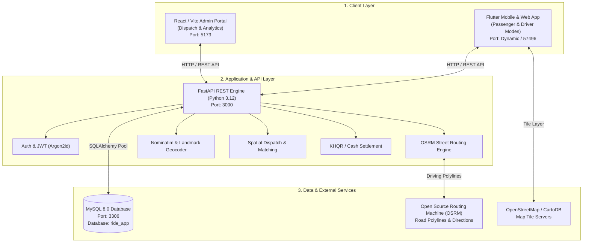
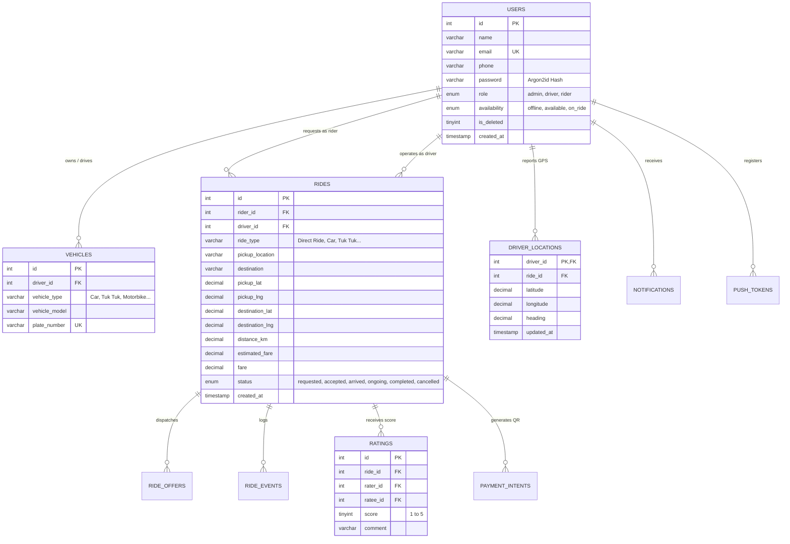
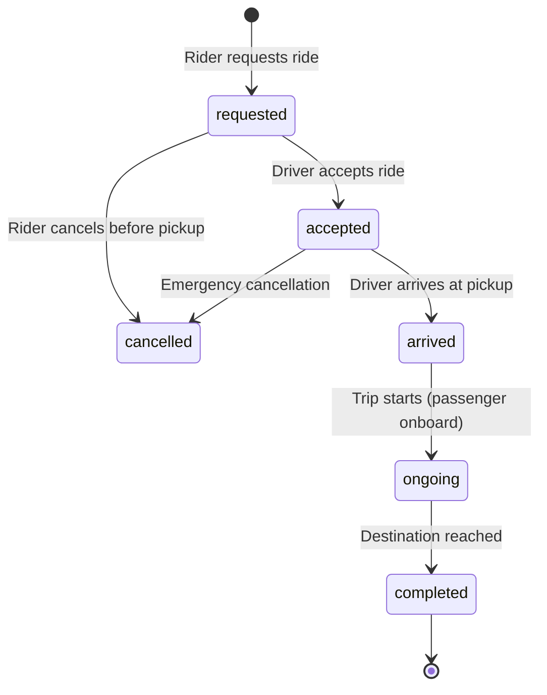

# How RideApp Works: Complete System Architecture & Operations Guide

> **RideApp** is a full-stack, on-demand ride-hailing and fleet management platform tailored for Cambodia. It provides passenger ride-booking, driver dispatch and navigation, live GPS tracking, dual-currency fare estimation (USD and KHR), Bakong KHQR digital payments, and a centralized web administration portal.

---

## Table of Contents
1. [High-Level Architecture](#1-high-level-architecture)
2. [Project Components & File Structure](#2-project-components--file-structure)
3. [Database Architecture (MySQL)](#3-database-architecture-mysql)
4. [Core Business Workflows](#4-core-business-workflows)
   - [Workflow A: Authentication & User Roles](#workflow-a-authentication--user-roles)
   - [Workflow B: Place Search, Street Routing & Fare Estimation](#workflow-b-place-search-street-routing--fare-estimation)
   - [Workflow C: Driver Matching & Dispatch](#workflow-c-driver-matching--dispatch)
   - [Workflow D: Ride Lifecycle & Live GPS Tracking](#workflow-d-ride-lifecycle--live-gps-tracking)
   - [Workflow E: Payments (Cash & Bakong KHQR) and Ratings](#workflow-e-payments-cash--bakong-khqr-and-ratings)
   - [Workflow F: Admin Operations & Revenue Analytics](#workflow-f-admin-operations--revenue-analytics)
5. [Accessible Web Portals & Test Accounts](#5-accessible-web-portals--test-accounts)
6. [How to Start & Verify All Services](#6-how-to-start--verify-all-services)

---

## 1. High-Level Architecture

The platform operates as a three-tier system:



---

## 2. Project Components & File Structure

| Folder | Technology | Purpose |
| :--- | :--- | :--- |
| [**`MOBILE/mobile/`**](../MOBILE/mobile) | Flutter 3.x / Dart | Cross-platform client for **Passengers** (search, booking, live tracking, receipts, ratings) and **Drivers** (online/offline toggle, ride accept/start/complete, GPS reporting). |
| [**`admin/`**](../admin) | React 19 / Vite / Tailwind-inspired CSS | Web operations portal for dispatchers and company administrators. Live trip radar, driver status management, income analytics, vehicle registry, and payout settlement. |
| [**`BACKEND/fastapi/`**](../BACKEND/fastapi) | FastAPI / Pydantic / SQLAlchemy | Core API microservice handling business logic, user auth, dynamic fare calculation, matching, road coordinates, and MySQL database persistence. |
| **Root Batch Scripts** | Windows Shell (`.bat`) | 1-click launchers: [`start_all.bat`](../start_all.bat), [`start_backend.bat`](../start_backend.bat), and [`start_mobile_web.bat`](../start_mobile_web.bat). |

---

## 3. Database Architecture (MySQL)

All persistent data is stored in the `ride_app` database on MySQL 8.0:



---

## 4. Core Business Workflows

### Workflow A: Authentication & User Roles
1. **Registration (`POST /api/register`)**:
   - The user inputs their Name, Email, Phone, Password (minimum 8 characters), and Role (`rider`, `driver`, or `admin`).
   - The backend hashes the password using high-security **Argon2id** (`pwdlib`). Plain-text passwords are never stored.
   - An account record is written to MySQL, and an **HMAC-SHA256 JWT** token is generated.
2. **Login (`POST /api/login`)**:
   - Validates credentials against stored Argon2id hashes (with automatic legacy bcrypt/HMAC migration support).
   - Returns a JWT token containing `sub` (User ID), `email`, and `role`.
3. **Role Enforcement**:
   - Protected API routes utilize `require_role("admin")`, `require_role("driver")`, or `require_role("rider")` to prevent unauthorized actions.

---

### Workflow B: Place Search, Street Routing & Fare Estimation

When a passenger selects where to go:

```mermaid
sequenceDiagram
    autonumber
    actor Rider as Passenger (Flutter App)
    participant API as FastAPI Backend (:3000)
    participant OSRM as OSRM Driving Engine
    participant DB as MySQL Database

    Rider->>API: GET /api/places/search?q=Aeon
    API-->>Rider: Returns landmarks (Aeon Mall 1, Aeon Mall 2...) with Lat/Lng
    Rider->>API: POST /api/fare/estimate (pickup_lat, pickup_lng, dest_lat, dest_lng, ride_type)
    API->>OSRM: GET /route/v1/driving/{pickup_lng},{pickup_lat};{dest_lng},{dest_lat}
    OSRM-->>API: Accurate Road Distance (2.36 km), Duration (3 min), 75+ Street Polyline Points
    API-->>Rider: Returns distance_km, estimated_duration_minutes, route_points, type_fares (USD & KHR)
    Rider->>Rider: Renders high-contrast road polyline on map along real streets
```

- **Dual-Currency Fare Engine**:
  - Automatically calculates rates for **Car**, **Comfort**, **Premium**, **Tuk Tuk**, and **Motorbike** based on Phnom Penh base fares + per-kilometer pricing.
  - Automatically converts USD to **Cambodian Riel (KHR)** at the fixed standard 4,100 KHR/USD rate, rounded to the nearest 100 Riel.

---

### Workflow C: Driver Matching & Dispatch

When a passenger taps **"Request Ride"**:
1. `POST /api/rides`: A new ride record is inserted with `status = 'requested'`.
2. **Spatial Discovery**:
   - The backend searches for drivers who are:
     - `role = 'driver'` and `availability = 'available'` (online).
     - Operating an assigned vehicle matching the requested vehicle type.
     - Within a **10 km radius** (calculated via Haversine great-circle formula) with recent GPS pings.
3. **Ride Offers**: An offer is inserted into `ride_offers`.
4. The driver's device receives the incoming ride request in their assigned trips list or via push notification.

---

### Workflow D: Ride Lifecycle & Live GPS Tracking



- **Live Driver GPS Tracking (`POST /api/driver-location`)**:
  - While online or during a trip, the driver's phone pings its current coordinates (`latitude`, `longitude`, `heading`).
  - Saved to `driver_locations`.
- **Passenger Live View (`GET /api/rides/{ride_id}/track`)**:
  - Returns the ride status, driver location, pickup, destination, and road polyline.
  - The Flutter map updates the taxi marker in real time along the street.

---

### Workflow E: Payments (Cash & Bakong KHQR) and Ratings

1. **Cash Payment**:
   - Upon completion, the driver collects cash in USD or KHR.
   - The driver enters the final collected fare and confirms completion.
2. **Bakong KHQR Payment (`POST /api/payments`)**:
   - Generates a standard National Bank of Cambodia (NBC) KHQR payload and QR code.
   - Passenger scans using their Bakong / ABA / Wing mobile banking app.
3. **Trip Receipt & Rating**:
   - Passengers receive an itemized receipt with breakdown (base fare, distance charge, date, driver name).
   - Passengers rate their driver (1 to 5 stars) with optional feedback comments saved to `ratings`.

---

### Workflow F: Admin Operations & Revenue Analytics

The React Admin Portal provides dispatchers and platform administrators with complete oversight:
- **Live Dispatch Radar**: Real-time overview of active trips across Phnom Penh with live status pills.
- **Financial Analytics**: Total gross revenue, platform commission fees, daily trip volume charts.
- **Fleet & Driver Approval**: Approve driver vehicle registrations, check license plate numbers, and toggle driver availability.
- **Driver Payout Settlement**: Track uncollected and settled cash earnings for each driver.

---

## 5. Accessible Web Portals & Test Accounts

### Web Portals
- **Admin Portal**: [`http://localhost:5173`](http://localhost:5173)
- **Mobile Client (Web)**: [`http://localhost:57496`](http://localhost:57496) *(or launched via `start_mobile_web.bat`)*
- **Interactive Swagger API Docs**: [`http://127.0.0.1:3000/docs`](http://127.0.0.1:3000/docs)
- **Health Verification**: [`http://127.0.0.1:3000/api/health`](http://127.0.0.1:3000/api/health)

### Verified Pre-Configured Test Accounts

| Role | Email | Password | Intended Interface |
| :--- | :--- | :--- | :--- |
| 🛡️ **Administrator** | `admin@rideapp.com` | `admin123456` | Admin Portal (`:5173`) |
| 🚖 **Driver** | `driver.sokha@rideapp.com` | `driver123456` | Mobile App (Driver Mode) |
| 👤 **Rider (Passenger)** | `rider.chenda@rideapp.com` | `rider123456` | Mobile App (Rider Mode) |
| 👤 **Rider (Passenger)** | `rider.david@rideapp.com` | `rider123456` | Mobile App (Rider Mode) |

*(You can also create your own custom account via the **Register** form; passwords must be 8+ characters.)*

---

## 6. How to Start & Verify All Services

### 1-Click Startup
From the project root folder:
1. Double-click [**`start_all.bat`**](../start_all.bat) &mdash; starts the FastAPI backend on port `3000` and Vite Admin on port `5173`.
2. Double-click [**`start_mobile_web.bat`**](../start_mobile_web.bat) &mdash; launches the Flutter passenger/driver client in Microsoft Edge.

### Running Test Verification Suites
Open a terminal in `BACKEND/fastapi`:
- **API Unit Tests**:
  ```powershell
  python -m pytest tests/test_api.py -v
  ```
- **Live MySQL End-to-End Smoke Test**:
  ```powershell
  python scripts/e2e_smoke.py --allow-writes
  ```
- **Flutter Code Analysis**:
  ```powershell
  cd ../../MOBILE/mobile
  flutter analyze --no-fatal-infos
  ```
